# Platter

A desktop music player for Plex libraries, for Windows and macOS. Playback,
search and the library cache run in Rust, so browsing is fast and your files
play at their original quality.

It's still young and changing quickly. Releases come often, and the app
updates itself.

Platter is an independent project and isn't affiliated with Plex, Inc. or
Spotify. See [TRADEMARKS.md](TRADEMARKS.md).

I listen to everything off my own Plex server. Plexamp is good, but I wanted
something that feels more like the big streaming apps: search that keeps up
with typing, quick browsing, a proper queue, mixes, a recap at the end of the
year. And I keep a lot of unreleased and alternate versions of albums, which
no Plex app really has a place for.

So Platter treats your server like a streaming catalogue, and has an archive
side for the stuff that never got an official release.

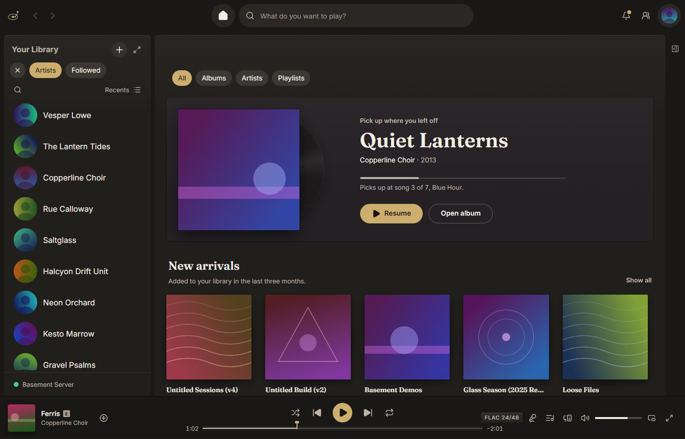

## Features

### Playing

- Plays your original files (FLAC, ALAC, MP3, AAC, WAV and so on), gapless when an album plays in order.
- Crossfade that only blends the quiet ends of songs, loudness leveling and a 10-band EQ.
- Automix blends songs on playlists and mixes on the beat, matching tempo and key when it can, and leaves albums alone.
- Headphone correction from the AutoEq project, applied before your own EQ and kept per output device.
- Bit-perfect output takes the device for itself (exclusive mode on Windows, hog mode on Mac) and plays each song at its own sample rate.
- Signal path: a badge in the player bar opens every step from the file to the output device, says whether what you hear is bit-perfect, and points at the setting to change if it isn't.
- A queue with drag and drop, a Recently played tab, an A-B loop and a "Next:" hint near the end of a song.
- Smart shuffle mixes similar songs from your library into a playlist or album, marked so you can tell them apart.
- Downloads of albums, playlists, Liked Songs and mixes, in original quality or as smaller MP3s, that keep playing with no server.
- A miniplayer with its own queue you can reorder, laid out side by side when the window is wide.
- A visualizer in now playing: a spectrum analyser, a pair of VU meters, a stereo scope or a soft glow from the cover. It only runs while it's on screen.
- Go Offline stops all network use, and a dropped server dims what isn't on this computer instead of breaking.
- Works with media keys and the Windows media flyout, and has a Mac menu bar, close to tray and start at sign-in.

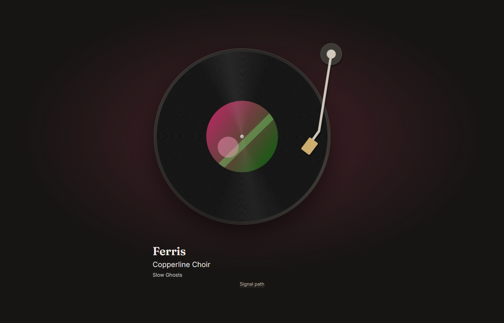

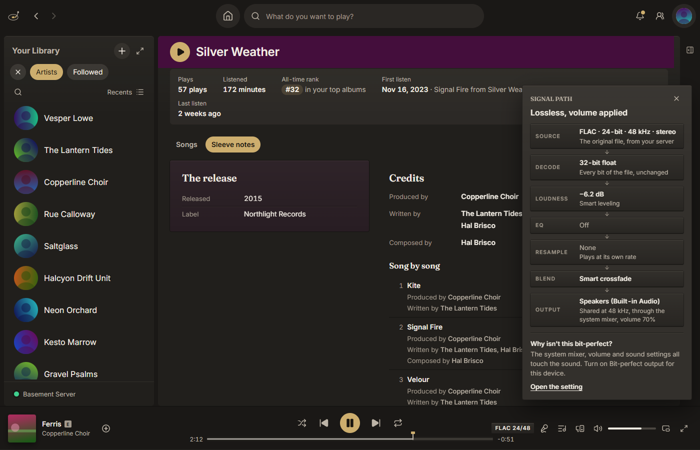

### Library and search

- Signs in with Plex in your browser, and the token lives in the OS keychain.
- Connects to your server directly, on your home network first, then remote access, then the relay.
- Keeps a local copy of the library, so search keeps up with typing and browsing works offline. New albums on a Plex server show up within seconds, no resync.
- Search forgives punctuation, so "tyler the maker" finds "Tyler, The Maker" and "kesha" finds "Ke$ha".
- Filter chips on albums, artists and songs: kind of release, lossless, hi-res, decade and added recently, remembered on this computer if you like.
- Search shows artists, albums and songs you don't have yet, with photos, and Get brings an album in through Lidarr in one click, following it until it's in your library.
- Sleeve notes for each album: release dates, label, edition and credits from your tags, Plex, MusicBrainz and Discogs. Every name opens a page with everything that person is credited on.
- Albums with a vinyl edition show Side A and Side B, and you can play one side or split any album into sides yourself.
- Crates file your library by label, producer, studio, era and genre, the way a record shop would.
- Likes, editable playlists, smart playlists built from rules, library folders, pins and bookmarks.
- Describe a playlist in plain words and get a smart playlist from your own library, worked out on your computer.
- Mixes made from your own listening: Daily Mixes, Discover, On Repeat, a daylist that changes through the day, and song and artist radio, all on one Radio and mixes page.
- Featured artists get pages of their own, and an artist's discography splits albums, singles and EPs and the rest by type, with the releases you don't have next to yours.
- More than one Plex server, Plex Home users, and editing covers, details and matches on servers you own.
- A library doctor that finds duplicates, missing covers and split albums, and asks before fixing anything.
- Identify by sound fingerprints untagged or mislabelled songs and suggests tags (off until you turn it on).
- A sound map lays your library out by how songs sound. Zoom around, click a dot to play it, or draw around a patch to make a playlist.
- Jellyfin and Subsonic servers (Navidrome and other OpenSubsonic servers) work alongside Plex or on their own, both in beta. A Subsonic server that moves keeps its music with Edit address, and plain http on the internet gets a warning before you sign in.

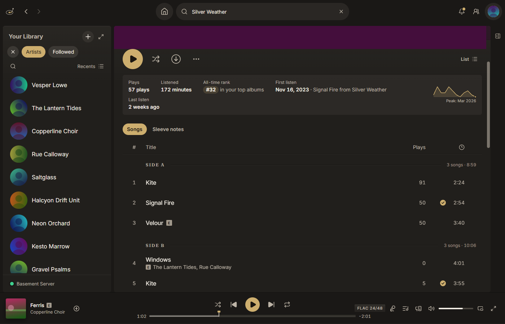

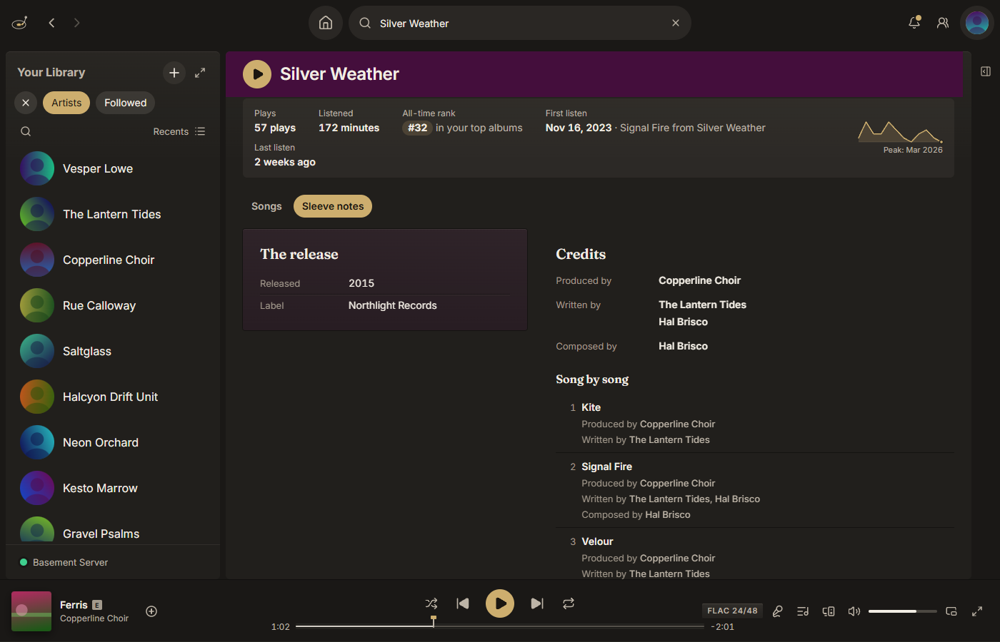

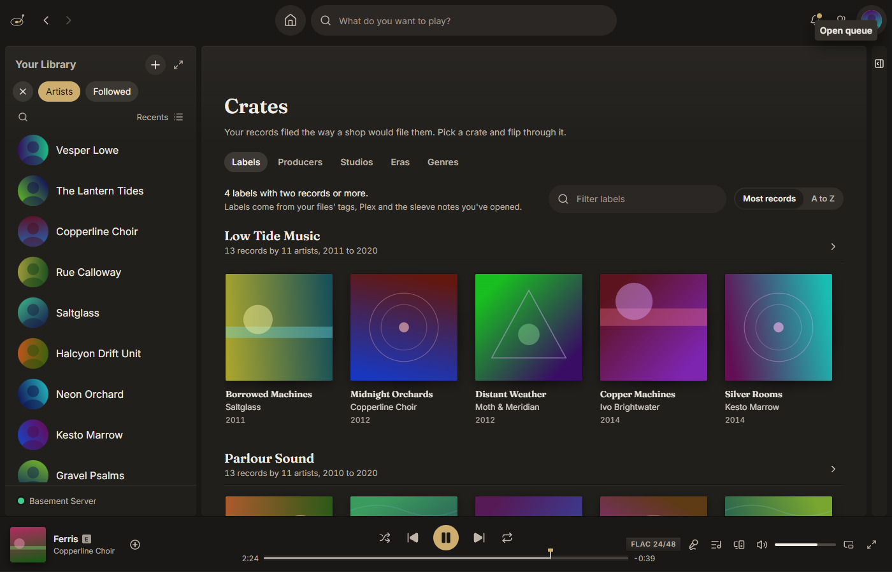

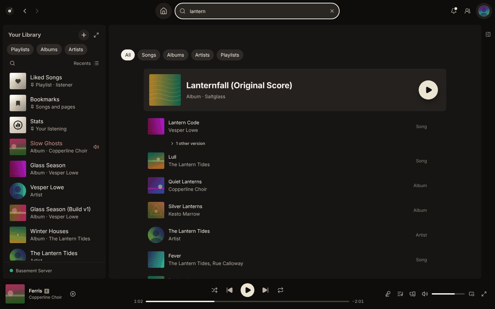

### Lyrics

- Synced lyrics in a full-window view, word by word when the file has word timing, and you can click a line to jump to it.
- Lyrics come from Plex, or from LRCLIB if you turn that on.
- With the speech model installed, lyrics are checked against the recording and only shown when the words match.
- Songs with no lyrics anywhere can be transcribed on your computer, and a background run can do your whole archive.
- A song you transcribe on one computer shows up on your others, and you can share it to LRCLIB after checking it.
- You can write and time your own lyrics, nudge the timing, or tap along to sync them.
- Lyrics show at once while they're checked, say when a song is instrumental, and offer Retry when a source can't be reached.
- Pronunciation lines for Japanese, Korean, Chinese, Hindi and Cyrillic lyrics, and translation through a service you set.

On Mac, transcription runs on the CPU for now.


### Archive

- An Archive page gathers your demos and unreleased albums.
- Albums and songs get a release status (official, unreleased, demo, leak and so on) from your tags, Plex's matches and MusicBrainz.
- It reads plain STATUS and VERSION tags, Picard's release status, or a tag you pick, and every guess has a "Why?" you can overrule.
- Artist pages have an Unreleased section, sections of your own and era cards.
- "Other versions" lists every copy of a song you have, and song lineage puts them on one timeline from demo to remaster.
- Compare two versions of a song by switching between them at the same moment, with matched levels.
- Editions of the same album fold into one card with an edition picker.
- Mark albums you own on vinyl, CD or cassette, or import a Discogs collection.

The tagging rules are in [docs/TAGGING.md](docs/TAGGING.md).

### Listening together and devices

- Every Platter signed into your account shows up in the device picker, and playback moves between them with the same queue.
- Listen on sends what you're playing to Plexamp and other Plex players, Sonos through Plex, Chromecast, AirPlay and DLNA receivers. It hasn't been tried on many real devices yet.
- Listen along with friends on your server or theirs, through an encrypted relay where nobody sees anyone's address.
- Server owners can see what others on the server are playing.
- Settings, pins, follows and your own lyrics can sync through a cloud folder you already use.
- Keep my devices in sync pairs your computers and phone with a short code and keeps settings, pins, looks and imported plays the same on each, over your home network first and an encrypted relay when you're away. Keys and passwords stay on the device they were entered on. In beta.
- Sync playlists, albums and Liked Songs to a USB drive, SD card or Rockbox player, as the original files or converted, copying only what changed.

### Stats

- A Stats page for any range, with minutes, top songs, artists, albums and genres, streaks and your busiest hours.
- A Profile page with your top artists and tracks this month, your playlists and your friends.
- On this day and Time travel on Home: what you played on today's date in earlier years, and a mix for each decade and for your year. Imported history counts too.
- Artist and album pages show your plays, first and last listen and all-time rank.
- Monthly recap cards and song share cards you can save as images.
- Your Plex play history, Tautulli and Last.fm scrobbles can count too, each play once.

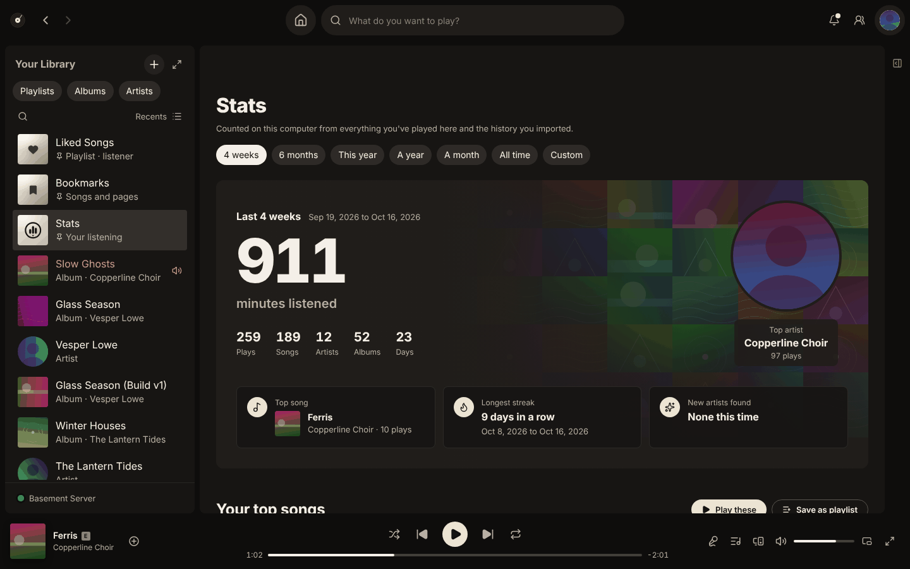

### Integrations

- Lidarr shows official albums you're missing, with a Request button, after checking it can't touch your existing music.
- A release radar for artists you follow, with requests through Lidarr if you have it.
- Library import reads exports from other services and transfer tools, and keeps a Missing list.
- Played a lot lists what your imported listening history played most that isn't in your library. Bring in my listening asks Lidarr for those albums a few a day, and pauses when Lidarr's queue or disk fills up.
- Away from home, your other devices reach Lidarr through a computer at home that has it set up. The key never leaves that computer.
- Platter Bridge is an optional small container for your server that does the same while every computer is off, and keeps Lidarr work like Bring in my listening going. It can start from its own settings and shows a pairing code in its log. See [docs/BRIDGE.md](docs/BRIDGE.md).
- Scrobbling to Last.fm and ListenBrainz, with unreleased songs left out unless you say so.
- Tautulli, read for plays from before you used Platter.
- Discord status with the album cover.
- A Stream Deck plugin with play, skip, like, volume, request and listen along keys (see [streamdeck/README.md](streamdeck/README.md)).
- Artist bios and facts from Wikipedia, and from Last.fm, Fanart.tv or TheAudioDB if you add a key.
- Prompted playlists through your own Anthropic key, hidden until you add one.

### Automation

- `platter://` links and a small command line play, pause, skip, like and open things from scripts and launchers.
- A local control API for tools like Home Assistant and Raycast, answering only programs on this computer.
- A local now playing feed for stream overlays and desktop widgets.

All of it is off by default. The details are in [docs/AUTOMATION.md](docs/AUTOMATION.md).

### Layouts and looks

- Six layouts arrange the window: Index (the default), Deck, Turntable, Gatefold, Console and Classic, or build your own. Each has a few options of its own, and Classic is one click away.
- Platter's own looks: Studio and Studio Black (dark, with a brass accent) and Sleeve (light). Classic, Classic light, Midnight, Forest and Sand are still there, or make your own with a live preview.
- In Studio, Studio Black and Sleeve, Home starts with records: the album you were partway through, then New arrivals, Spun this week, Finish what you started and Not played in a year.
- The expanded view can show a record player, with the cover as the label and a tonearm that lowers when music plays. The seek bar can be a stylus on a groove line.
- Settings in ten groups with a side menu and search, and each integration on a page of its own.
- A layout section for the sidebar, the player bar, Home shelves and list columns.
- Albums with no cover art get a printed sleeve with their title instead of a blank square.
- Keyboard shortcuts everywhere (Ctrl+/ or Cmd+/ lists them), and a power mode with jump hints.

<!-- Layout screenshots go in docs/screenshots/, one per layout, taken from the demo library. -->

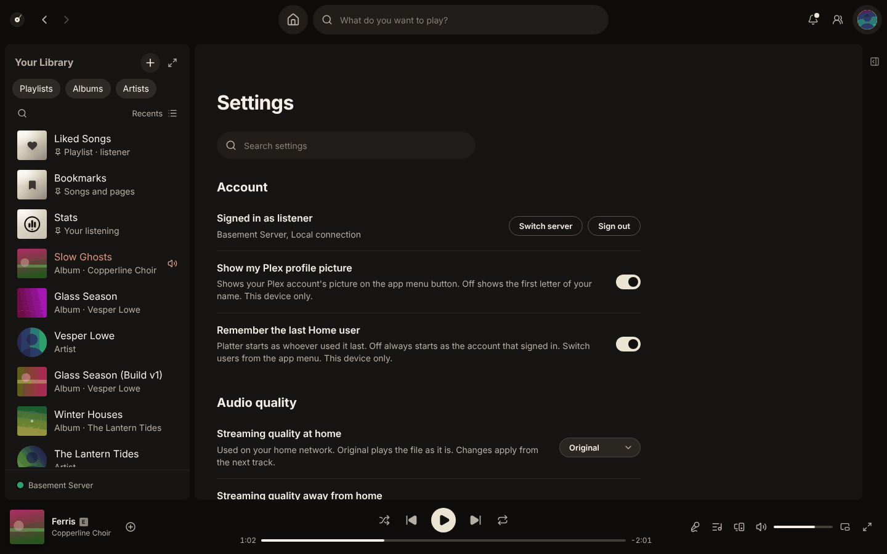

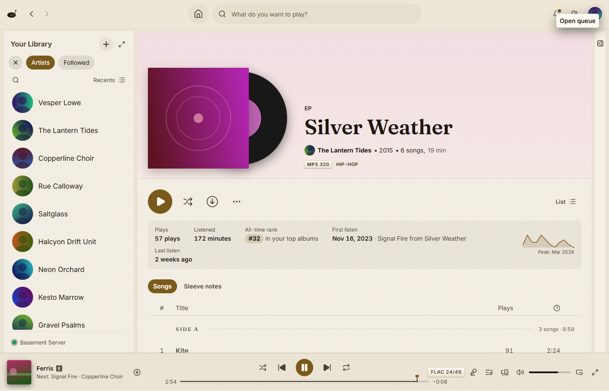

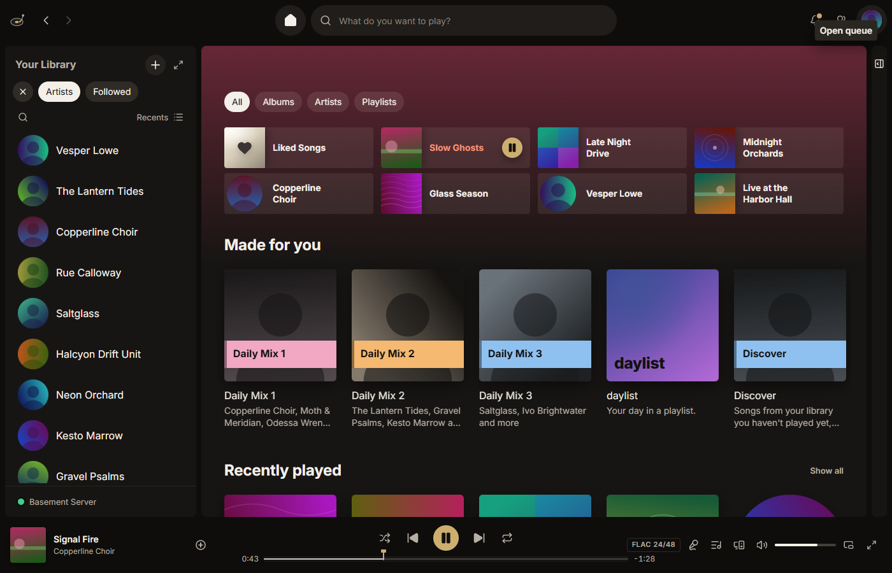

The screenshots come from the app's built-in demo library (made-up artists
and generated artwork), never from a real server.

## Roadmap

What I'm working towards next:

- Getting Jellyfin and OpenSubsonic out of beta once they've been tried on more real servers.
- Testing Listen on with more speakers and players.
- Transcription on the Mac's GPU.
- A code-signed Windows installer.
- Fixing file tags from inside the app. For now the library doctor shows them and you change them in a tagger.

Mobile might happen after 1.0.

## What it isn't

It only plays music, and only from servers you can reach. There's no outside
catalogue to stream from. Recommendations and mixes come from your own
library, and music you don't have is shown but can't be played.

Nothing needs to be installed on your server. Platter Bridge is the one
optional extra, and everything works without it.

It's also one person's project, built around how I listen. There will be bugs
I haven't run into yet.

## Help

Help is built into the app (it works offline) and published from the same
pages in [docs/help](docs/help) as a small site with GitHub Pages.

## Privacy

Platter talks to your own servers, to plex.tv (to sign in and find your
server) and to GitHub (for updates). Everything else is a service with its
own switch in Settings, and anything that sends data elsewhere, writes to
your server or opens a port stays off until you turn it on (the first-run
guide offers the common ones). There's no analytics or crash reporting that leaves your
machine. The full list is in [PRIVACY.md](PRIVACY.md).

## Building it

1. Install Git, Node.js 22+, and Rust (<https://rustup.rs>).
2. On Windows, install Visual Studio Build Tools with "Desktop development
   with C++" (WebView2 already ships with Windows 11). On macOS, run
   `xcode-select --install`.
3. `npm install`
4. `npm run tauri dev`

`npm run dev` on its own opens the interface in a browser with the demo
library, no server needed.

Discord status needs a Discord application id, read when the app is
compiled. Create an application in the Discord Developer Portal and set
`PLATTER_DISCORD_APP_ID` to its id before building, for example
`PLATTER_DISCORD_APP_ID=<your app id> npm run tauri build`. Without it the
build works the same, and Settings says Discord status isn't available.

Lyrics transcription (whisper.cpp) is the `transcribe` Cargo feature, which
release builds turn on: `npm run tauri build -- --features transcribe`. It
needs CMake and libclang (LLVM on Windows). On Windows and Linux it also runs
on the graphics card with Vulkan, so building needs the Vulkan headers and
`glslc`: the LunarG Vulkan SDK on Windows (with `VULKAN_SDK` set), and
`libvulkan-dev` and `glslc` on Debian and Ubuntu. People using Platter need
only their graphics driver; without one it uses the processor. On Windows the
Vulkan shader build can pass the 260 character path limit; build with a
short `CARGO_TARGET_DIR` (for example `C:\t`) if it fails with `FTK1011`. On macOS,
setting `WHISPER_DONT_GENERATE_BINDINGS=1` skips the libclang step. Without
the feature everything else builds the same, and Settings says transcription
isn't in this build.

Run the tests with `npm test`, and `cargo clippy -- -D warnings && cargo test`
inside `src-tauri/`. There's a bit more in [CONTRIBUTING.md](CONTRIBUTING.md).

```
docs/            Plex API notes, tagging rules, IPC contract, automation
src/             React + TypeScript interface
src-tauri/       Rust core: audio, Plex client, cache + search, platform glue
streamdeck/      Stream Deck plugin, built on its own (see its README)
```

## How it's made

I'm building Platter with a lot of help from AI (Claude Code). Other apps are
only a reference for how things should behave. No code, assets or text are
taken from them.

## Contributing

Issues and pull requests are welcome, and I'd especially like to hear from
people whose library or setup looks different from mine. Ideas can go in
Discussions. Please report security issues through [SECURITY.md](SECURITY.md)
rather than a public issue.

## Licence

GPL-3.0-or-later. The Platter name and brand artwork aren't covered by that
licence; see [TRADEMARKS.md](TRADEMARKS.md). "Plex" and "Spotify" are
trademarks of their respective owners.
