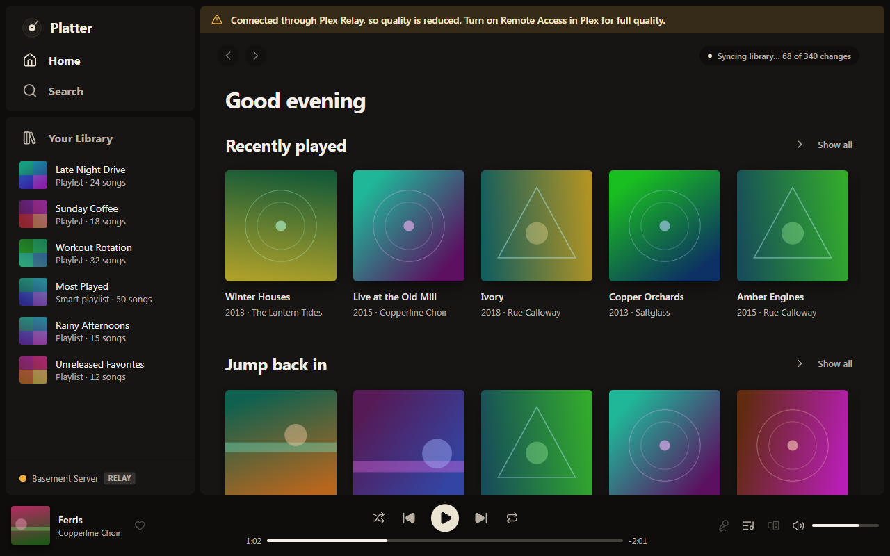

# Connecting to your server

How Platter reaches your music server at home and away from home, what the relay is, and how to switch between servers.

## How Platter finds your server

When you sign in with Plex, Platter asks plex.tv for your server's addresses, tries them all at once and picks the best one that answers:

1. On your home network, when your computer and the server are on the same network.
2. Away from home, through Plex's Remote Access, when that's turned on in Plex.
3. Through the Plex relay, when nothing else works.

Platter checks the connection every 30 seconds. If you change Wi-Fi network, or your server's address changes, it finds the new way in by itself.

## Checking your connection

The dot at the bottom of the sidebar, next to your server's name, shows how you're connected. A **Remote** badge means you're connected from outside your home network. A **Relay** badge means you're going through the Plex relay.

Click the dot for details, like how fast the server answers and whether your music files can be read.

## Home and away from home

You can pick a different quality for each.

- Settings, Sound, Streaming quality at home is Original to begin with, which plays each file as it is.
- Settings, Sound, Streaming quality away from home is 320 kbps to begin with. Your server makes an MP3 at that rate.

A file that's already smaller than the chosen rate plays as it is. Changes apply from the next song.

## The Plex relay

When your server can't be reached directly, Plex passes the music through its relay. It works anywhere, but never sends more than 128 kbps, so quality drops and Platter shows a banner.

To get full quality away from home, turn on Remote Access in your Plex server's settings. Platter moves to the better connection by itself once it can.

Downloads wait while you're away from home, unless you turn off Settings, Downloads and devices, Download only on your home network. See [Downloads and offline](downloads-and-offline.md).

## On a Mac

macOS can keep apps off your home network. If it does, Platter shows "macOS is blocking Platter from your home network". Open System Settings, Privacy & Security, Local Network, and turn on Platter. Platter moves back to your home network once you allow it.

## Switching servers

Settings, Account and servers, Music servers lists every server Platter uses.

- Press **Add a server** to add another Plex, Jellyfin or Subsonic server.
- Press **Make primary** on a server to make its library your main one.
- Press **Remove** to take a Jellyfin or Subsonic server out.

Settings, Account and servers, Servers and libraries adds music libraries from your other Plex servers and from servers shared with you. With more than one server in, the sidebar has a Show music from menu: pick All servers to see everything together, or one server to see only its music.

### Plex Home users

If your Plex account is a Plex Home, switch users from the app menu. Each user keeps their own library, likes, history, queue, downloads and settings. Settings, Account and servers, Remember the last Home user decides whether Platter starts as whoever used it last.

## Jellyfin and Subsonic servers

Platter also plays from Jellyfin, and from Navidrome and other Subsonic servers. Both are in beta. You type your server's address, so these servers have no relay: your computer has to be able to reach that address.

1. Open Settings, Account and servers, Music servers and press **Add a server**, or choose one on the welcome screen.
2. Pick Jellyfin, or Navidrome or another Subsonic server, and type its address.
3. For Jellyfin, approve Platter with a Quick Connect code or sign in with your password. For a Subsonic server, use an API key (the safer choice) or your password.

Subsonic servers can't tell Platter when their music changes, so Platter asks every 5 minutes. You can change that in Settings, Account and servers, Check Subsonic servers for changes every.

Settings, Account and servers, Keep my queue on the server saves your queue on servers that can hold one, so another app signed in to the same account can pick it up. It writes to your server, so it's off until you turn it on.

When something goes wrong, see [Troubleshooting](troubleshooting.md).
