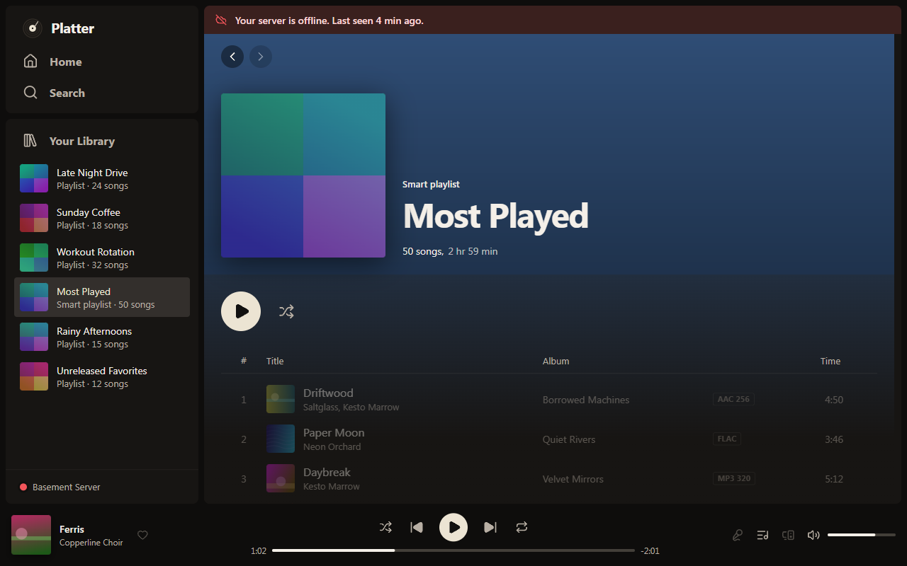

# Downloads and offline

How to keep music on your computer, choose its quality and size, and what still works without your server.

## Downloading music

You can download albums, playlists, mixes and Liked Songs.

1. Open the album, playlist, mix or Liked Songs.
2. Press the download button next to the play button.
3. Platter fetches the songs in the background, one at a time. The button shows how far it has got.

Playing always comes first, so downloads never get in the way of what you're listening to. If you close Platter, downloads carry on where they stopped next time.

Downloaded items get a small mark. In Your Library, the Downloaded chip shows only what's on this computer.

Downloaded playlists and Liked Songs stay up to date. Songs you add are downloaded too, and a song you take out is removed from your computer once nothing else you downloaded needs it.

To keep Liked Songs on this computer all the time, turn on Settings, Downloads and offline, Download Liked Songs.

### Removing downloads

Press the download button again and confirm **Remove**. Platter tells you how much space that frees. To remove everything, use **Remove all downloads** in Settings, Storage.

## Download quality

Settings, Audio quality, Download quality decides what gets saved:

- Original keeps each file as it is, at full quality. This is the usual setting.
- 320, 192 or 128 kbps MP3 are smaller files your server makes, which take less space.

A change applies to new downloads. Songs you already downloaded stay as they are.

Some Jellyfin and Subsonic accounts aren't allowed to download. Settings, Library, Music servers says so under the server, and the server's owner can allow it.

## Storage and the limit

Settings, Storage shows how much space your downloads use.

- Download storage limit stops downloads at the size you pick, from 5 GB to 500 GB (20 GB to begin with). A banner tells you when downloads have stopped. Remove some or raise the limit to carry on.
- Download location is the folder downloads are kept in. Changing it moves them there.
- Artwork and cache size limits the space cover art takes. Clearing it frees the space, and art downloads again as you browse.

Downloads also stop if your computer runs out of space.

## Downloading at home only

Settings, Downloads and offline, Download only on your home network is on to begin with. Downloads wait while you reach your server from away from home or through the Plex relay, and carry on when you're home. Turn it off to download anywhere. See [Connecting to your server](connecting.md#home-and-away-from-home).

## Go offline

Go offline stops Platter using the network. Turn it on from the app menu, or in Settings, Downloads and offline, Go offline.

While it's on, nothing goes to your server, plex.tv, artist info sources, lyrics lookups, Discord, share links or update checks. Only music on this computer plays. The one exception is a speech model download you start yourself in Settings. Turn Go offline off to use your server again.

## What works offline

The same happens when your server is down, your internet drops, or you turn on Go offline. An icon in the top bar tells you why.

- Downloaded songs play as usual.
- Songs Platter saved ahead of time for the queue play too (see Settings, Playback, Songs to load ahead).
- Songs that aren't on this computer are dimmed. If you play a list that has some, Platter skips them and tells you once.
- Home shows an On this computer shelf with what you can play.
- You can browse your library and search it, since Platter keeps a copy on your computer.

Some things need the server or the internet and wait until they're back, such as the About the artist section and credits in the now playing panel.

When your server is reachable again, everything comes back by itself and Platter says "Your server is back."

<!-- TODO: confirm whether lyrics for downloaded songs show while offline. -->

If downloads seem stuck, see [Troubleshooting](troubleshooting.md).
