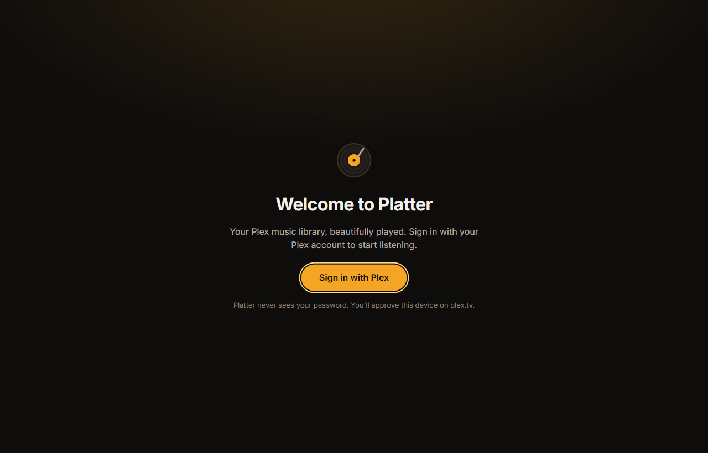

# Getting started

How to sign in, choose your music, pick a look and find your way around Platter.

## Signing in with Plex

Platter plays music from your own Plex server. You sign in through plex.tv in your browser, so Platter never sees your Plex password.

1. Open Platter and press **Sign in with Plex**.
2. Platter opens plex.tv in your browser. Sign in there and approve Platter. If plex.tv asks for a code, type the one Platter shows.
3. Come back to Platter. It finds your server by itself and starts reading your library.

If the browser didn't open, press **Copy sign-in link** and paste it into your browser yourself. **Cancel** stops the sign-in.

If your account can reach more than one Plex server, Platter asks you to choose the one that has your music. You can add the others later (see [Picking libraries](#picking-libraries)).

Your sign-in is kept in your computer's keychain. To sign out, use **Sign out** in the app menu.

### No Plex account

You can also use a Jellyfin server, or Navidrome or another Subsonic server, without Plex. On the welcome screen, press **Use a Jellyfin server** or **Use Navidrome or another Subsonic server** and follow the steps. Both are in beta. [Connecting to your server](connecting.md#jellyfin-and-subsonic-servers) has the details.

## Your first library sync

The first time, Platter reads your whole library and keeps a copy on your computer. Progress shows at the top of the window, and you can start playing straight away. After that, Platter picks up changes on its own.

If something ever looks out of date, use Settings, Library, Resync library.

## Picking libraries

Your server's main music library is always in. To add more music:

1. Open Settings and go to Library.
2. Under Servers and libraries, turn on the music libraries you want, from your other Plex servers or from servers shared with you.

An album that's on two servers shows once and plays from the best copy. [Connecting to your server](connecting.md#switching-servers) has more about using several servers.

## Picking a look

Right after you sign in for the first time, the Get started guide walks you through your libraries, a look, Discord and online look-ups. You can skip it, and open it again any time from Settings, Setup guides. With setup guides turned off, Platter offers **Pick a look** instead.

In the look step, choose a ready-made look (Dark, Light, Midnight, Forest, Sand, High contrast or OLED black), or press **Make your own** to build one with a live preview.

You can change it any time in Settings, Appearance, Look. Settings, Appearance, Theme also has Match system, which follows your computer's light or dark mode.

## Discord

Settings, Integrations, Discord, Show what you're playing on Discord is off until you turn it on, in the Get started guide or in Settings. While it's on, music plays and the Discord app is open on this computer, your Discord profile shows the song, artist, album and cover. A private session hides it. [Privacy](privacy.md#discord) explains what goes to Discord.

<!-- TODO: Settings says Discord status isn't available in builds made without a Discord application id. Check whether release builds always have it. -->

## Sleeve notes

An album page has two tabs under its buttons: Songs and Sleeve notes. Sleeve notes is the back of the record: when and where it was recorded, the label, catalogue number, format, edition, country and barcode, the release's own notes, and who made it. Credits are listed for the whole album (produced by, written by, the musicians and what they played, engineered, mixed and mastered by) and then song by song.

Every name is a link. It opens a page with everything in your library that person is credited on, grouped by what they did. A song's menu has **Credits** too, for that one song, in the expanded view as well.

### Where the facts come from

Point at a fact, or move to it with Tab, and small marks show where it came from: **Tags** for your files' own tags, **Plex**, **MB** for MusicBrainz and **Discogs**. A line at the bottom of the tab says what the marks mean. When sources agree, every one is marked. When they disagree, your files' tags win, then Plex, then MusicBrainz, then Discogs.

Settings, Library, Look up credits online asks MusicBrainz (when MusicBrainz is on, Settings, Integrations, Artist info) and Discogs (once you've added a Discogs token) when you open the tab. What they say is kept on your computer, so offline you still see it. Unreleased albums are never looked up. Turn off Show sleeve notes to hide the tab and the Credits item.

### Record sides

When an album has a vinyl edition on MusicBrainz or Discogs, its songs are grouped under Side A, Side B and so on (A to D for a double album). Each side's heading has a play button, and the album's menu has Play side A, Play side B, which play just that side. For any other album, Split into sides in the album's menu lets you tick the songs each new side starts on. Your split is kept on every computer you sync, and No sides takes it away. Sides never change the order an album plays in.

Settings, Playback, Pause to flip at the end of a side (off at first) works with the record player in the expanded view: when an album plays from one side into the next, playback stops, the tonearm lifts, and Flip to side B plays on. Turn off Settings, Library, Show vinyl sides to hide sides everywhere.

## First steps

- Press **Home** in the sidebar to see what you played lately and the mixes made for you.
- Search for an artist, album or song with the box at the top, or press `Ctrl+L` (`⌘L` on a Mac). See [Search](search.md).
- Like a song with the plus that shows when you point at it, or with the heart in the player bar. Liked songs gather in Liked Songs in Your Library.
- Play an album and open the queue to see what's next. See [Playing music and the queue](playing-and-queue.md).
- Download an album or playlist to play it without your server. See [Downloads and offline](downloads-and-offline.md).

## Where to find Settings

Click your profile picture (or the first letter of your name) at the top of the window to open the app menu, then choose **Settings**. You can also press `Ctrl+,` (`⌘,` on a Mac). At the top of Settings, Search settings finds a setting by its name or description.

The app menu also has the miniplayer, Private session, Go offline, Check for updates, Keyboard shortcuts and Sign out.

## Getting help

These help pages are built into Platter and work offline. Choose **Help** in the app menu to see them all, or search for anything and press the **Help** chip. Busier screens have a small **?** that opens the right page beside them, and many settings have **Learn more**. Settings, App, Show "?" help buttons hides the **?** buttons.

Settings, Setup guides has short guides for getting started, Lidarr, library import, inviting a friend and Stream Deck. Each one picks up where you left it.

Press `Ctrl+/` (`⌘/` on a Mac) for the list of keyboard shortcuts. `Ctrl+K` (`⌘K` on a Mac) opens quick search and commands.

If something isn't working, [Troubleshooting](troubleshooting.md) is a good place to start.
