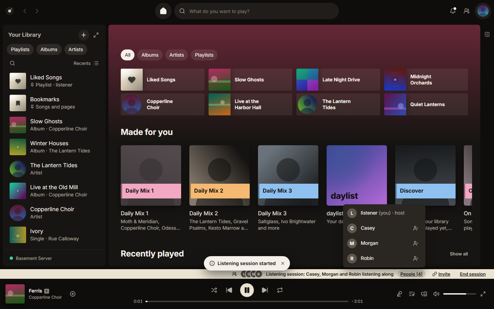

# Listening together

How to host a listening session, invite people, see what friends play, show sessions on Discord and share links to music.

## Start a listening session

1. Choose Start a listening session from a song, album or playlist menu, or from the Listen along card in the queue panel.
2. A strip above the player bar shows the session and who is listening.
3. Choose Invite on the strip to ask people in.

## Invite links and QR codes

The invite shows a link and a QR code. Choose Copy link and send it, or let someone scan the code. When they open the link, Platter opens and joins the session.

Each link works for one person, once. It stops working after the time in Settings, Social, Listening sessions, Invites expire after (1 hour, 24 hours or 7 days). Choose New link for the next person.

<!-- TODO: confirm how a guest uses the QR code, since Platter is a desktop app and the code holds the same platter:// join link. -->

## What guests hear and do

Each guest plays from your Plex library when they have access to it, else from their own copy of the same song. A copy of a different length shows as Another version. When a guest has no copy, their player pauses with Not in your library and picks up at the next song they have.

- Guests can always add songs with Add to the session's queue, and the queue shows who added each one.
- With Settings, Social, Listening sessions, Let others change what's playing on, guests can also play, pause, skip and reorder. Off, they can only add.
- Your name in listening sessions is what others see. Leave it empty to use your Plex name. Nobody sees your email, location or computer.
- Unreleased songs only play for people with access to your library. Turn on Hide unreleased titles from guests to hide their title and artist too.

## Removing people and ending

Choose People on the strip to see everyone. Next to each guest is a Remove button. A removed guest leaves the session at once.

As host, End session stops it for everyone and forgets every invite. As a guest, choose Leave.

## The relay

Everyone connects only to a relay, never to each other, so nobody learns anyone else's address, and messages are sealed end to end. The default relay is ntfy.sh (free, about 250 messages a day per connection). To use your own ntfy server, put its address in Settings, Social, Listening sessions, Relay for listening sessions.

## Discord

While you host, Settings, Integrations, Discord, Show the Listen along button on Discord makes your Discord status show the session and how many are listening. Joining from Discord isn't there yet, so send the invite link. How unreleased songs show on Discord is on [Archive and release status](archive-and-release-status.md#how-unreleased-music-is-treated).

## Friend activity

The people button in the top bar shows what others on your Plex server played in the last week. Turn it on or off with Settings, Social, Friend activity, Show friend activity. Only the server's owner can see it, because Plex shares listening with the owner only.

Share my activity with Platter friends lets Plex show what you're playing right now. It's off until you turn it on. While it's off, or in a private session, friends don't see you live. Songs you finish still go into Plex's history, which the server's owner can see.

## Share links

The Share menu on songs, albums, artists and playlists offers:

- Copy song link (or album link): a song.link page that opens the music in any music service. It needs Settings, Sharing, Public links for released music. Platter finds it with iTunes Search, sending only the artist, title and album. Unreleased music never gets one.
- Copy Platter link: opens the item in Platter for people on your Plex server. It never holds your server's address.
- Copy link at a time, for the song playing now.
- Share card (not for artists): an image to copy or save, with a QR code (Share cards include a QR code) and the song.link line (Include the song.link line). Nothing is uploaded.
