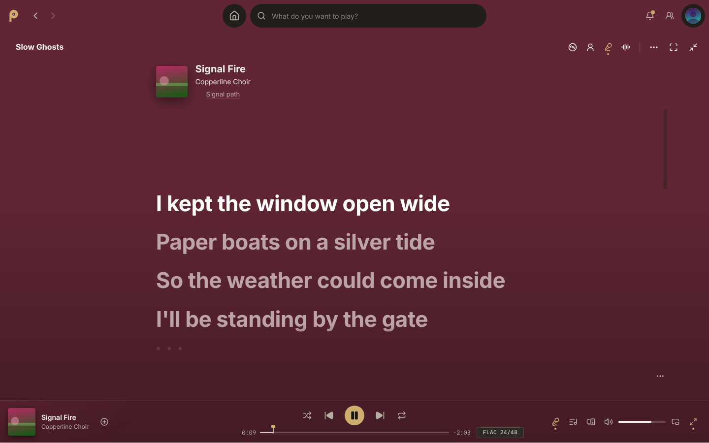

# Lyrics and transcription

Where lyrics come from, what Platter does when a song has none, and how to fix the odd one that's wrong.

## Where lyrics come from

Press the lyrics button and the words are there. Platter looks in this order:

1. Your server: a `.lrc` or `.txt` file next to the song, or lyrics your server has.
2. Lyrics you wrote in Platter.
3. LRCLIB, a free lyrics library.
4. Lyrics Platter wrote down from the song itself, when nothing else has them.

The quiet line under the lyrics says which one you're seeing. To show your own lyrics first, turn on Prefer my own lyrics over your server's (Settings, Lyrics, More).

### When there are none

If a lyrics source couldn't be reached, the view says Couldn't get lyrics right now. Press Retry, or wait: Platter asks again when you're back online. That's different from no lyrics anywhere, and from This song is instrumental, which shows when the title says instrumental or karaoke, or LRCLIB marks the song that way.

### LRCLIB

Settings, Lyrics, Lyrics from LRCLIB when your server has none is on. Platter sends the song's artist, title, album and length, and keeps answers for 30 days. Turn it off and nothing is sent.

## Writing down songs without lyrics

On a computer, a song with no lyrics anywhere gets them written down as it plays. The lyrics view shows Writing down the words with a line that fills, then the lyrics replace it. The next songs in the queue are done ahead of time, so most songs already have lyrics when they start. The audio never leaves your computer.

The first time, Platter downloads its speech model, which takes a minute or two. The view says Getting ready to write down lyrics, first time only.

Lyrics written this way can have mistakes. Fix them with Edit lyrics in the options menu. To stop it, turn off Settings, Lyrics, Write down lyrics for songs without them.

A Platter Bridge on your server can do every song in your library overnight instead, so your computers and phone already have them.

### Unreleased songs

Settings, Lyrics, Lyrics transcription has Transcribe all unreleased music without lyrics, which works through them in the background, resting between songs. It pauses on battery power and gives way to playback.

## Behind the scenes

Platter listens to a short part of the song and checks that the lyrics found belong to it, and that they're in time. Lyrics that belong to another song are swapped for ones that match. Lyrics that run early or late are moved. None of this needs anything from you.

## Wrong lyrics?

The options button under the lyrics (or a song's menu) has Wrong lyrics?. It lists every set found. Pick another set, or choose Transcribe this song, Write or paste lyrics, or No lyrics for this song. Let Platter pick goes back to automatic. Look again asks the lyrics sources again, in case they have the song now.

If the timing is off, choose Timing is off. Use the minus and plus buttons (or the `-` and `+` keys) to move the lyrics half a second at a time, or Tap to sync and click a line as it's sung.

Your picks and timing win over everything automatic. Settings, Lyrics, Lyrics choices and timing has Reset.

## Writing your own

Choose Write your own or Edit lyrics in the options menu and type or paste the words, one line each. To sync them, play the song and press `Space` as each line starts. Your lyrics stay in Platter, never in your music folder, and Export .lrc saves a copy.

## Translation and pronunciation

Show pronunciation adds a romanised line under Japanese, Korean, Chinese, Hindi and Cyrillic lyrics, made on this computer.

For translation, put the address of a LibreTranslate-compatible service in Translation service address, and pick a language in Translate lyrics into. The options menu then has Translate. With no service set, nothing is sent.

## Transcription

Write down lyrics for songs without them is on for computers. Albums have Transcribe songs without lyrics in their menu too. The speech model uses the graphics card when there's one that helps, and the processor at low priority otherwise.

### Sharing transcriptions

Sync transcriptions to my devices sends them through your sync file, so each song is written down once. It needs Lyrics you wrote on under Sync.

With Offer to share transcriptions publicly on, a transcription you've reviewed gets Share these lyrics publicly in the options menu. It shows exactly what goes to LRCLIB and asks every time. [Unreleased songs](archive-and-release-status.md) are left out unless you turn on Including unreleased songs, because sharing makes the title public.
