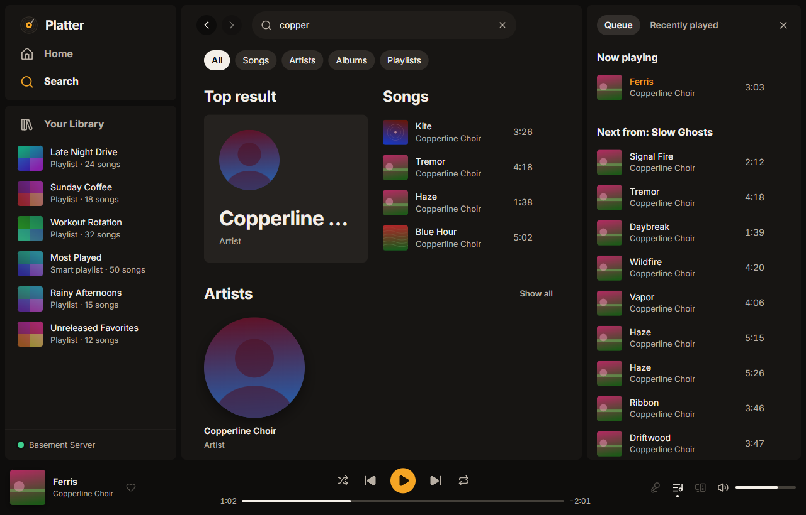

# Playing music and the queue

How to play music, use the queue and shuffle, and shape the sound with crossfade, leveling and the equalizer.

## Playing music

Press the play button on an album, playlist, artist or mix, or double-click a song. With a song selected, `Enter` plays it. The player bar at the bottom has the controls, the seek bar and the volume.

An album played in order runs from one song to the next with no gap. The repeat button moves through off, repeat all and repeat one.

Playing an album or playlist again picks up at the song and spot where you stopped. Turn that off in Settings, Playback, Albums and playlists resume where you left off.

When the queue runs out, Platter keeps playing similar music from your library. To stop instead, change Settings, Playback, When the queue ends to Stop.

## The queue

Press the queue button in the player bar, or `Alt+Shift+Q`, to open the queue.

- Now playing is the song you're hearing.
- Next in queue holds songs you added yourself. They play before anything else.
- Next from (or Next up) is the rest of the album, playlist or mix you're playing.

To add a song, choose **Add to queue** from its menu, or drag it into the queue. Drag songs in the queue to change their order. **Clear queue** removes the songs you added, after asking.

The Recently played tab lists what you played before.

Platter saves the next few songs on your computer ahead of time, so they start at once and keep playing if your connection drops. Settings, Playback, Songs to load ahead sets how many (5 to begin with).

## Shuffle

Press the shuffle button or `Ctrl+S` (`⌘S` on a Mac). Settings, Playback, Shuffle style decides how songs are mixed:

- Spread (the usual setting) keeps songs by the same artist apart.
- Standard is a plain random order.

On playlists and Liked Songs, the shuffle button has a third setting, smart shuffle. It adds a suggestion from your library after every two songs, marked with a sparkle in the queue. Turn it off in Settings, Playback, Smart shuffle.

## Crossfade

Settings, Playback, Crossfade songs blends one song into the next.

- Smart (the usual setting) overlaps only the quiet end of a song and the quiet start of the next, so songs that end suddenly aren't cut.
- Fixed length fades over the number of seconds you set, from 1 to 12.
- Off plays each song to its end.

Skipping always cuts straight to the next song. Settings, Playback, Never crossfade within an album is on to begin with, so albums play straight through.

## Loudness leveling

Settings, Sound, Level loudness between songs plays songs at a similar volume, using Plex's loudness analysis. Smart keeps an album's own dynamics when you play it in order, and levels each song otherwise. You can also pick Track, Album or Off.

Settings, Sound, Volume before the equalizer raises or lowers every song, and Settings, Sound, Keep loud parts from distorting stops loud peaks from distorting.

## Equalizer

Turn on Settings, Sound, Use the equalizer to shape the sound with ten bands. Drag the points, or pick a preset such as Bass boost, Vocal or Late night. You can save your own and give each output device its own profile.

Settings, Sound, Headphone correction evens out the sound of your headphones with a measured profile for your model.

## Signal path

The badge in the player bar shows the playing song's format, like FLAC 24/48. Click it to see each step the sound takes from the file to your output device: the source, decoding, loudness, the equalizer, resampling, crossfade or Automix, and the output. The top line sums it up in plain words, like "Bit-perfect", "Lossless, volume applied" or "Lossy source (MP3 320)".

When the sound isn't bit-perfect, Why isn't this bit-perfect? says what changes it, and Open the setting takes you to the setting that would. The expanded view and the More player options menu open the same panel. Turn the badge off with Settings, Sound, Show the signal path badge.

## Record player

In the expanded view, the cover becomes the label of a record. It spins up when music plays and stops when you pause, and a tonearm lowers onto it and lifts off. Settings, Appearance, Record player can also turn the cover in the side panel, or turn the record off. With Reduce motion on, the record stays still.

Settings, Appearance, Tonearm seek bar draws the seek bar as a stylus on a groove line. It works the same as the plain one.

Albums split into sides can pause at the end of each side, so you flip the record. See [Record sides](getting-started.md#record-sides).

## Miniplayer

The miniplayer is a small window with the cover and controls. Open it from the player bar. It stays above other windows unless you turn off Settings, Appearance, Miniplayer always on top. Settings, Appearance, Show the queue in the miniplayer lists what's next when the window is at least 500 tall, and makes a shorter window taller when you turn it on. Click a song to play it, drag songs to reorder them, or right-click one to play it next, remove it or go to its album. With the keyboard, the arrow keys move through the list, Enter plays, Delete removes and Alt with the up or down arrow moves a song. Space plays and pauses. A window much wider than it is tall puts the title, progress and queue beside the cover; turn off Miniplayer side by side when wide to keep it stacked.

## Keyboard shortcuts

Press `Ctrl+/` (`⌘/` on a Mac) to see every shortcut. The ones you'll use most:

- `Space` plays or pauses.
- `Ctrl+→` and `Ctrl+←` go to the next or previous song.
- `Shift+→` and `Shift+←` jump 5 seconds forward or back.
- `Ctrl+↑` and `Ctrl+↓` change the volume.
- `Alt+Shift+B` likes or unlikes the playing song.

On a Mac, use `⌘` in place of `Ctrl` and `⌥` in place of `Alt`. The play, next and previous keys on your keyboard or headset work too, even when Platter is in the background (Settings, App, Media keys).

Settings, App, Keyboard power mode labels everything you can click with letters you type.
