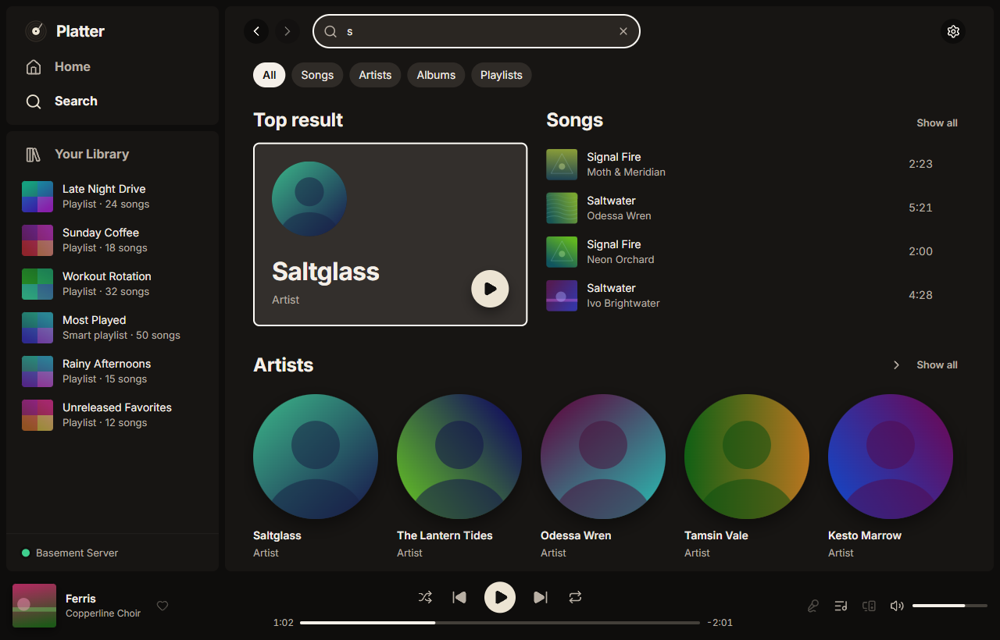

# Search

How to find music in your library with the search box, the filters, recent searches and the command palette.

## Searching your library

Click the search box at the top of the window ("What do you want to play?"), or press `Ctrl+L` (`⌘L` on a Mac), and start typing. Platter searches the copy of your library it keeps on your computer, so results keep up with your typing.

While you type, suggestions show under the box: ways to finish your words, then matching artists, albums, songs and playlists.

- Use `↑` and `↓` to move through them.
- `Enter` opens the one you picked, or shows every result for what you typed.
- `Shift+Enter` adds the highlighted song to your queue.
- `Esc` closes the list.

If you'd rather not see suggestions, turn off Settings, Search, Show suggestions as you type.

## Results and filters

The results page starts with a top result, then songs, artists, albums and playlists. Chips at the top narrow it down: All, Songs, Albums, Artists or Playlists.

When you have more than one version of a song, a line under it says how many other versions there are. Click it to see them all.

Your Library in the sidebar has its own filter. Press `Ctrl+F` (`⌘F` on a Mac) to search it, and use its chips (Playlists, Albums, Artists, Downloaded and others) to show only one kind.

## Forgiving search

You don't need to type names exactly.

- Accents don't matter: "beyonce" finds "Beyoncé".
- Common shorthand matches the full word, like "thru" and "through", or "pt 2" and "part II".
- Hyphens, apostrophes and spaces fold together, so "kayq" also finds "Kay-Q".
- Words can be in any order, and small words like "the" or "and" can be left out.
- The start of a word is enough: "radi" finds "Radio".

When the words as you typed them find very little, Platter also shows close spellings below the exact matches, and offers the corrected spelling at the top of the suggestions. This works for words of five letters or more. Turn it off in Settings, Search, Forgive typos in search.

## Recent searches

Things you open from search are remembered. Click the empty search box to see them under Recent searches. Each one has a button to remove it from the list.

Recent searches are kept on this computer only. To stop remembering them, turn off Settings, Search, Remember recent searches. To empty the list, press **Clear recent searches** there.

## Music that isn't in your library

Search can also show artists, albums and songs you don't have, in with your own results. They look like your other results, and an artist you don't have can even be the top result. When something is in your library and the wider catalogue too, your copy comes first with a small "In your library" note. Each kind shows as soon as it arrives.

When Lidarr is set up, artists and albums come from Lidarr's own search, which is quick and has pictures. Otherwise, and for songs, they come from MusicBrainz, which answers one question a second. Platter only asks once you stop typing, and only sends what you typed. You can pick the source in Settings, Search, Where music you don't have comes from.

Get on an album sends it to Lidarr in one click, with all of Platter's checks, and you have a few seconds to undo it. The button then follows it: Looking on your indexers, Downloading, Importing, and In your library. If nothing turns up, Platter asks Lidarr to search again after an hour, six hours and a day, then once a day for a week, before it says Not found yet with Search again and Try another edition. Your very first request asks you to type the album's name, and an album a check won't allow says Needs you with the reason. Turn on Ask before each Get to see every request first. On a song, Get the album asks for the album it's on.

An artist's page has Get albums, which asks which kinds you want (studio albums to start with; EPs, live albums and compilations if you like), says how many, and sends them a few at a time, most popular first.

It's on unless you turn it off in Settings, Search, Show music you don't have in search. What you type goes to your Lidarr, or to MusicBrainz without Lidarr. See [Privacy](privacy.md) for what goes where.

## Searching while offline

When Platter can't reach your server, search still shows what it finds in the copy of your library on your computer. Only searches that need the server wait until it's back. See [Downloads and offline](downloads-and-offline.md).

## The command palette

Press `Ctrl+K` (`⌘K` on a Mac) to open quick search and commands. Type a few letters to:

- Jump to a page, like Home, Recents, Settings or your albums.
- Run a command, like play or pause, next, shuffle, repeat or the volume.
- Open an artist or album, or play a song, straight from your library.
- Choose Search for "your words" to open the full results page.

Use `↑` and `↓` to move and `Enter` to pick. `Esc` closes it.
