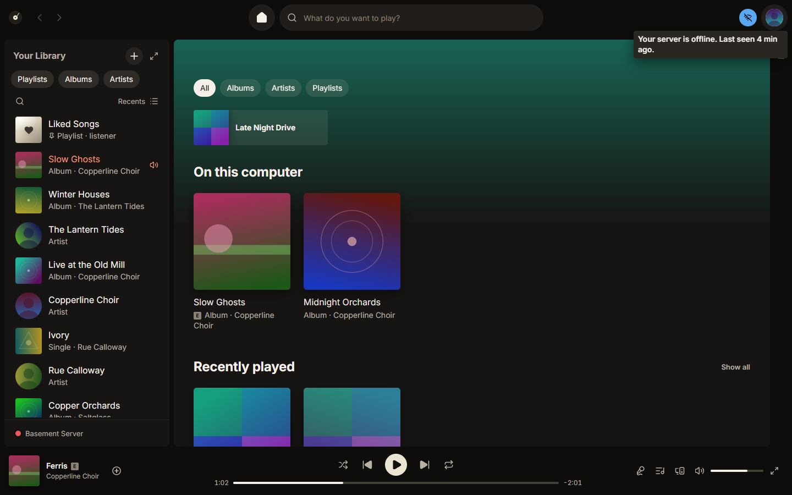

# Troubleshooting

Common problems, what Platter is telling you, and how to fix them.

## Can't connect

- "Please sign in again." Your Plex sign-in ran out or was removed. Choose **Sign in**. Music already on this computer keeps playing meanwhile.
- "You no longer have access to this server." The owner removed you, or the server was shared differently. Pick another server, or choose **Use another account**.
- On a Mac, "macOS is blocking Platter from your home network." Choose **Open Settings**, then in Privacy & Security, Local Network, turn on Platter.
- See [Connecting](connecting.md) for the first steps.

## Offline

When Platter can't reach your server, a small offline icon appears in the top bar. Its tooltip says why, for example "Your server is offline. Last seen 4 min ago." or "You're offline." if this computer has no connection.

While you're offline, music stored on this computer still plays. Songs that aren't on this computer are dimmed and skipped. Everything comes back on its own, and Platter says "Your server is back."

If the tooltip says you turned on Go offline, turn it off in the app menu. To keep music for times like this, see [Downloads and offline](downloads-and-offline.md).

## Server unreachable or slow

- "Server is starting…" or "Server is updating…" means Plex is restarting. If it takes more than two minutes, Platter says so; check that Plex is running on the server.
- "Your server is up, but your music files aren't available." Plex is running but can't see the music, for example a drive is unplugged or not mounted. Fix that on the server and the message clears by itself within a minute.
- When you reach the server away from home, a badge by its name says so, and music streams at 320 kbps.
- A Relay badge means only Plex's relay works. It's slower, and songs are limited to 128 kbps. Setting up access away from home in Plex usually fixes this.

## No music library

"No music library found." means the server has no music library Platter can use. Choose **How to add one** for the steps in Plex. Platter looks again every minute, so the library appears as soon as Plex has one.

## Disk full

When this computer gets low on space, Platter first clears its oldest stored music and shrinks the artwork cache. If space is still low it says "Not enough space."

If downloads stop with a banner about the storage limit, remove some downloads or raise Settings, Downloads and devices, Download storage limit. You can also lower Settings, App, Artwork and cache size.

## Lyrics wrong

1. In the lyrics view, choose **Wrong lyrics?** to pick other lyrics that were found, or turn lyrics off for that song.
2. If the words are right but the timing is off, use the minus and plus buttons (or the `-` and `+` keys) to move them by half a second.
3. To have Platter skip lyrics that belong to another song, turn on Settings, Lyrics, Check lyrics against the song. It needs the speech model on this computer.

Lyrics marked "Not checked" may be for another version. See [Lyrics and transcription](lyrics-and-transcription.md).

## Discord not showing

1. Check that the Discord app is open on this computer. Platter shows your status once it is.
2. Check Settings, Integrations, Discord, Show what you're playing on Discord is on. It's off until you turn it on.
3. A private session hides your status. So does an unreleased song if you turned off showing them.

If Discord shows the Platter icon instead of the cover, the cover couldn't be found or uploaded. It tries again on the next play.

## Lidarr check failing

- "Lidarr isn't reachable." Check the address and port, and that Lidarr is running.
- "Lidarr didn't accept this API key." Copy it again from Lidarr's Settings, General.
- An old version or "doesn't answer like Lidarr" means you need Lidarr 2.0 or later at that address.
- Red findings explain what to change in Lidarr. See [Lidarr](lidarr.md#the-safety-check).

## Reporting a problem

If something still doesn't work, open an issue at https://github.com/Silvercyclops999/platter/issues. Say what you did, what you expected, what happened, and the exact words Platter showed. Mention your system and Platter's version.

If Platter crashed, a crash report is saved on this computer in the crash-reports folder of Platter's data folder. It's never sent anywhere, so attach it yourself if you want to.
<!-- TODO: where Platter's data folder (crash-reports) and any log files are on each system, and whether the app has a way to open them -->

Please report security problems privately, as described in Platter's security notes, not in a public issue.
